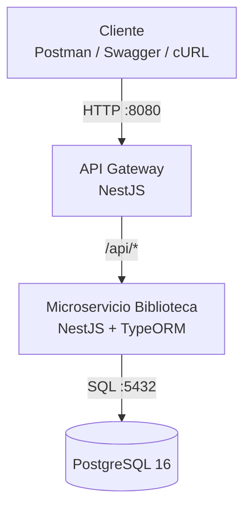

# Biblioteca Digital — API Gateway y Microservicio

API REST para administrar autores y libros, construida con **NestJS**, **TypeORM** y **PostgreSQL**, con una arquitectura de microservicios desplegada mediante **Docker Compose**.

El sistema expone un único punto de entrada público a través de un API Gateway. El gateway aplica CORS, registro de solicitudes, identificadores de seguimiento y limitación de peticiones; después redirige las rutas `/api/*` al microservicio de biblioteca.

## Tabla de contenido

- [Características](#características)
- [Arquitectura](#arquitectura)
- [Tecnologías](#tecnologías)
- [Estructura del proyecto](#estructura-del-proyecto)
- [Requisitos](#requisitos)
- [Instalación y ejecución](#instalación-y-ejecución)
- [Servicios y puertos](#servicios-y-puertos)
- [Documentación de la API](#documentación-de-la-api)
- [Endpoints](#endpoints)
- [Ejemplos de uso](#ejemplos-de-uso)
- [Base de datos](#base-de-datos)
- [Comandos útiles](#comandos-útiles)
- [Solución de problemas](#solución-de-problemas)
- [Seguridad y configuración](#seguridad-y-configuración)

## Características

- CRUD de autores: crear, consultar, actualizar y eliminar.
- CRUD de libros: crear, consultar, actualizar y eliminar.
- Relación entre autores y libros.
- PostgreSQL como base de datos relacional.
- Validación de datos de entrada mediante `ValidationPipe`.
- Documentación interactiva con Swagger.
- API Gateway como punto de entrada para las peticiones.
- CORS configurable mediante variables de entorno.
- Identificador `x-request-id` y registro de método, ruta, estado HTTP y duración.
- Límite de 100 solicitudes por minuto y por IP en el gateway.
- Contenedores con Docker Compose y comprobaciones de salud (*health checks*).
- Datos iniciales de prueba: 10 autores y 20 libros.

## Arquitectura



El cliente se comunica únicamente con el gateway. El gateway reenvía las rutas que comienzan con `/api` al backend dentro de la red privada `app-net`. El backend consulta y modifica la base de datos PostgreSQL.

Diagramas C4 disponibles en `docs/diagramas-c4/`:
- `c4_nivel1_contexto.png`: diagrama de contexto.
- `c4_nivel2_contenedores.png`: diagrama de contenedores.
- Los archivos SVG correspondientes están disponibles en la misma carpeta.

## Tecnologías

| Tecnología | Uso |
|---|---|
| Node.js | Entorno de ejecución |
| NestJS 10 | Gateway y microservicio |
| TypeScript | Lenguaje de desarrollo |
| TypeORM | Mapeo objeto-relacional |
| PostgreSQL 16 | Base de datos relacional |
| Docker Compose | Orquestación de contenedores |
| Swagger / OpenAPI | Documentación interactiva de la API |
| `http-proxy-middleware` | Redirección de solicitudes desde el gateway |
| `express-rate-limit` | Limitación de solicitudes |

## Estructura del proyecto

```text
biblioteca-microservicios/
├── backend/                  # Microservicio de autores y libros
│   └── src/
│       ├── autores/          # Módulo, controlador, servicio, entidad y DTO
│       ├── libros/           # Módulo, controlador, servicio, entidad y DTO
│       ├── health.controller.ts
│       ├── app.module.ts
│       └── main.ts
├── gateway/                  # API Gateway y proxy inverso
│   └── src/
│       ├── app.module.ts
│       └── main.ts
├── db/
│   └── init.sql              # Esquema y datos iniciales
├── docs/
│   └── diagramas-c4/         # Diagramas de arquitectura
├── .env.example              # Ejemplo de variables de entorno
├── .gitignore
├── docker-compose.yml
└── README.md
```

## Requisitos

- [Git](https://git-scm.com/)
- [Docker Desktop](https://www.docker.com/products/docker-desktop/) en Windows, o Docker Engine en Linux.
- Docker Compose v2, normalmente incluido con Docker Desktop.

No es necesario instalar Node.js ni PostgreSQL en el equipo si se ejecuta todo mediante Docker Compose.

## Instalación y ejecución

### 1. Clonar el repositorio

Reemplaza la URL por la URL real del repositorio de GitHub:

```bash
git clone https://github.com/Twokarma/Examen-Practivo-Gateway-y-Microservicio.git
cd biblioteca-microservicios
```

**Importante:** ejecuta `cd` en la carpeta que contiene directamente `docker-compose.yml`, `.env.example`, `backend/`, `gateway/` y `db/`.

### 2. Crear el archivo de entorno

En Windows PowerShell:

```powershell
Copy-Item .env.example .env
```

En Linux o macOS:

```bash
cp .env.example .env
```

El archivo `.env.example` contiene valores de ejemplo. Puedes modificar `.env` según tu entorno local.

### 3. Construir e iniciar los servicios

```bash
docker compose up --build -d
```

Verifica el estado de los contenedores:

```bash
docker compose ps
```

Consulta los registros si algún servicio no inicia:

```bash
docker compose logs -f
```

Cuando el gateway esté disponible, abre:

- API: <http://localhost:8080>
- Swagger: <http://localhost:8080/api/docs>
- Health del gateway: <http://localhost:8080/health>

### 4. Detener los servicios

```bash
docker compose down
```

Este comando detiene y elimina los contenedores, pero conserva el volumen de datos de PostgreSQL.

## Servicios y puertos

| Servicio | Puerto interno | Acceso desde el equipo | Función |
|---|---:|---|---|
| `gateway` | 3000 | `http://localhost:8080` | Punto de entrada público |
| `backend` | 3001 | No se publica directamente | CRUD y lógica de biblioteca |
| `db` | 5432 | No se publica directamente | PostgreSQL |

Los tres servicios se comunican a través de la red Docker `app-net`. El único puerto publicado en el equipo es el del gateway (`8080`).

## Documentación de la API

Con los contenedores en ejecución, visita:

**Swagger UI:** <http://localhost:8080/api/docs>

Desde Swagger puedes revisar los esquemas, consultar las operaciones y enviar solicitudes de prueba.

## Endpoints

Todas las rutas de negocio se consumen a través del gateway y usan el prefijo `/api`.

### Autores

| Método | Ruta | Descripción |
|---|---|---|
| `POST` | `/api/autores` | Crear un autor |
| `GET` | `/api/autores` | Listar autores |
| `GET` | `/api/autores/:id` | Consultar un autor por ID |
| `PATCH` | `/api/autores/:id` | Actualizar parcialmente un autor |
| `DELETE` | `/api/autores/:id` | Eliminar un autor |

### Libros

| Método | Ruta | Descripción |
|---|---|---|
| `POST` | `/api/libros` | Crear un libro |
| `GET` | `/api/libros` | Listar libros |
| `GET` | `/api/libros/:id` | Consultar un libro por ID |
| `PATCH` | `/api/libros/:id` | Actualizar parcialmente un libro |
| `DELETE` | `/api/libros/:id` | Eliminar un libro |

### Salud de los servicios

| Método | Ruta | Descripción |
|---|---|---|
| `GET` | `/health` | Comprueba el gateway |
| `GET` | `/health` en el backend interno | Comprueba el microservicio |

La ruta de salud del backend se utiliza internamente en las comprobaciones de Docker Compose.

## Ejemplos de uso

Los siguientes ejemplos usan `curl`. Puedes ejecutarlos desde una terminal con `curl` disponible.

### Listar autores

```bash
curl http://localhost:8080/api/autores
```

### Consultar libros

```bash
curl http://localhost:8080/api/libros
```

### Crear un autor

```bash
curl -X POST http://localhost:8080/api/autores \
  -H "Content-Type: application/json" \
  -d '{"nombre":"Gabriel García Márquez","nacionalidad":"Colombiana"}'
```

### Crear un libro

El campo `autorId` debe corresponder al ID de un autor existente.

```bash
curl -X POST http://localhost:8080/api/libros \
  -H "Content-Type: application/json" \
  -d '{"titulo":"Libro de ejemplo","isbn":"978-0000000001","anioPublicacion":2026,"disponible":true,"autorId":1}'
```

### Actualizar la disponibilidad de un libro

```bash
curl -X PATCH http://localhost:8080/api/libros/1 \
  -H "Content-Type: application/json" \
  -d '{"disponible":false}'
```

### Eliminar un libro

```bash
curl -X DELETE http://localhost:8080/api/libros/1
```

Los ejemplos de creación modifican la base de datos. Para las pruebas, utiliza registros de ejemplo o datos que puedas eliminar después.

## Base de datos

PostgreSQL 16 utiliza el script `db/init.sql`, que crea las siguientes tablas:

### `autores`

- `id`: identificador autogenerado.
- `nombre`: nombre del autor.
- `nacionalidad`: nacionalidad, opcional.

### `libros`

- `id`: identificador autogenerado.
- `titulo`: título del libro.
- `isbn`: ISBN único.
- `anioPublicacion`: año de publicación, opcional.
- `disponible`: indica si el libro está disponible.
- `autorId`: referencia al autor; permite valor nulo y usa `ON DELETE SET NULL`.

El script carga 10 autores y 20 libros de prueba. Docker ejecuta los scripts de inicialización de PostgreSQL cuando el directorio de datos está vacío; si el volumen ya contiene una base de datos, los cambios en `db/init.sql` no se aplican automáticamente.

### Consultar la base de datos

```bash
docker exec -it biblioteca-db psql -U biblioteca -d biblioteca_db
```

Dentro de `psql`, puedes ejecutar:

```sql
SELECT * FROM autores;
SELECT * FROM libros;
```

Para salir:

```text
\q
```

### Reiniciar la base de datos desde cero

**Advertencia:** el siguiente comando elimina el volumen de PostgreSQL y, con él, los datos guardados en esa base de datos.

```bash
docker compose down -v
docker compose up --build -d
```

## Comandos útiles

```bash
# Construir e iniciar
docker compose up --build -d

# Ver estado
docker compose ps

# Ver registros de todos los servicios
docker compose logs -f

# Ver registros de un servicio
docker compose logs -f gateway
docker compose logs -f backend
docker compose logs -f db

# Reiniciar servicios
docker compose restart

# Detener y eliminar contenedores sin borrar el volumen de datos
docker compose down
```

## Solución de problemas

**El puerto 8080 ya está ocupado**

Cierra la aplicación que lo utiliza o cambia el puerto publicado en `docker-compose.yml`. Por ejemplo, `8081:3000` permitiría acceder al gateway mediante `http://localhost:8081`.

**El gateway no responde o devuelve un error del proxy**

Comprueba el estado y los registros:

```bash
docker compose ps
docker compose logs -f gateway backend
```

El gateway espera a que el backend esté saludable y el backend espera a que PostgreSQL esté listo.

**Se modificó `db/init.sql`, pero no aparecen los cambios**

El script de inicialización solo se ejecuta cuando PostgreSQL crea un directorio de datos vacío. Para volver a inicializar la base de datos, elimina el volumen con `docker compose down -v` y vuelve a iniciar los servicios. Esto borra los datos existentes.

**La API rechaza datos enviados**

Revisa la respuesta HTTP y los DTO de creación o actualización. La API valida los datos recibidos y rechaza propiedades que no estén permitidas.

**Docker Compose no encuentra `.env`**

Comprueba que `.env` esté en la misma carpeta que `docker-compose.yml` y que hayas creado el archivo a partir de `.env.example`.

## Seguridad y configuración

- No subas el archivo `.env` al repositorio. Está incluido en `.gitignore`; utiliza `.env.example` como plantilla.
- Cambia las credenciales de ejemplo antes de usar el proyecto fuera de un entorno local.
- `CORS_ORIGIN=*` es una configuración abierta para desarrollo. En un despliegue real, limita los orígenes permitidos.
- El rate limiting configurado en el gateway es una medida básica; no reemplaza autenticación, autorización ni otras medidas de seguridad.
- El backend y PostgreSQL no publican puertos en el equipo anfitrión en la configuración actual.

## Flujo de ramas

Para organizar el desarrollo en equipo se puede utilizar el siguiente esquema:

- `main`: versión estable.
- `develop`: integración de cambios.
- `feature/*`: nuevas funcionalidades.
- `release/*`: preparación de una versión.
- `hotfix/*`: correcciones urgentes.

Este apartado describe una estrategia sugerida; no implica que todas esas ramas ya existan en el repositorio.
